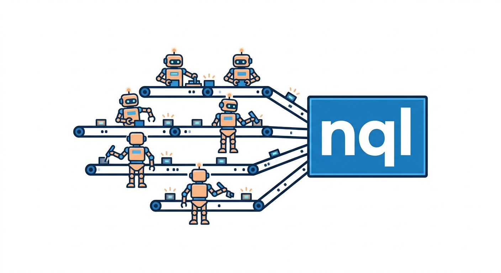

<p align="center">
  <a href="https://github.com/NPC-Worldwide/nql">
    
  </a>
</p>

# nql

<p align="center">
  <a href="https://github.com/NPC-Worldwide/nql/blob/main/LICENSE"></a>
  <a href="https://crates.io/crates/nql"></a>
</p>

_**NQL: a dbt-style SQL compiler with AI function calls, targeting multiple databases. Write models as plain `.sql` files, call LLMs from inside the query, and let nql compile each call down to native AI SQL — BigQuery `AI.GENERATE`, Snowflake `CORTEX`, pgai on PostgreSQL, or local UDFs on SQLite.**_

<p align="center">
  
  
</p>

---

## Install

### Cargo

```
cargo install nql
```

### Pre-built binaries

Download the latest release from [GitHub releases](https://github.com/npc-worldwide/nql/releases).

---

## Quick Start

```
nql compile my_model --models-dir ./models --target sqlite
nql run my_model --models-dir ./models --db ./data.db --target sqlite
nql run --models-dir ./models --db ./data.db   # runs all models in dependency order
```

- `compile` prints the target SQL without executing (dry-run).
- `run` executes the compiled SQL against the warehouse. Omit the model name to run every model in `{{ ref() }}` dependency order.
- For `sqlite` and `bigquery` targets, runner executes directly. For other targets the compiled SQL is printed.

## Models

A model is a plain `.sql` file with YAML config in leading comments and `{{ ref('other_model') }}` for dependencies:

```sql
-- config:
--   materialized: table
--   schema: insights

SELECT
    user_id,
    nql.summarize(bio) AS bio_summary,
    nql.extract_entities(bio) AS entities
FROM {{ ref('stg_users') }}
```

### Config keys

| Key | Values | Effect |
|-----|--------|--------|
| `materialized` | `view` (default), `table`, `incremental`, `ephemeral` | `view` → `CREATE OR REPLACE VIEW`; `table` → `CREATE TABLE IF NOT EXISTS ... AS`; `incremental` requires `unique_key`; `ephemeral` is inlined, never created. |
| `unique_key` | column name | With `incremental`, compiles to a `CREATE TABLE ... WHERE FALSE` seed plus `INSERT ... WHERE NOT EXISTS` on the key, so reruns merge new rows only. |
| `schema` | schema/dataset name | Prefixes the model's output name. |

### Refs

`{{ ref('model_name') }}` resolves to the model's fully qualified output name and wires dependencies so `nql run` executes everything in topological order.

## `nql.*` AI functions

Available to every model. At compile time each call becomes the target's native AI SQL — an LLM never needs to be wired in by hand.

| Function | What it does |
|----------|--------------|
| `nql.generate_text(text[, prompt])` | Free-form completion over a column |
| `nql.summarize(text)` | Concise summary |
| `nql.analyze_sentiment(text)` / `nql.sentiment(text)` | Sentiment label |
| `nql.translate(text[, lang])` | Translation |
| `nql.extract_entities(text)` | Named entities |
| `nql.generate_embedding(text)` | Text embedding |
| `nql.generate_json(prompt_text)` | Structured JSON output from a full prompt |
| `nql.classify(text)` / `nql.classify_into(text, categories)` | Open / closed classification |
| `nql.detect_language(text)` | ISO 639-1 language code |
| `nql.answer_question(context, question)` | QA over a passage |
| `nql.generate_code(task)` | Code for a task |
| `nql.criticize(text)` | Critical analysis of a text |
| `nql.synthesize(text)` | Distill to essence |
| `nql.get_facts(text[, topic])` | JSON-array fact extraction |
| `nql.identify_groups(items)` | Name the groups in a set of items |
| `nql.generate_groups(items)` | Generate groupings from items |
| `nql.remove_redundant_groups(groups)` | Merge/drop overlapping groups |
| `nql.assign_groups_to_fact(...)` | Assign items to refined groups |
| `nql.get_related_facts_llm(...)` | Find related facts |
| `nql.get_related_concepts_multi(...)` | Related concepts per item |
| `nql.consolidate_facts(...)` | Consolidate overlapping facts |
| `nql.find_best_link_concept(...)` | Best linking concept |
| `nql.prune_fact_subset(...)` | Prune a fact subset |
| `nql.breathe(text)` | Extract objective, last task, accomplishments, failures as JSON |
| `nql.zoom_in(...)` / `nql.abstract(...)` | Drill down / abstract out along an ontology |

### Group-analysis trio

`identify_groups` / `generate_groups` → `remove_redundant_groups` → `assign_groups_to_fact` implement a patent-inversion pipeline entirely in SQL: generate raw groups per cell of data, refine (merge/drop) the group list per partition, then assign each row's facts back to the refined groups — one call per group, not per row. This makes it practical to run structured LLM analysis over hundreds of thousands of rows for a few hundred calls.

### Argument note

Argument extraction treats parentheses naïvely, so pass bare columns or pre-built expressions — build `CONCAT` prompt strings in an upstream CTE and reference the column name, rather than nesting function calls directly inside an `nql.*` call.

## Targets

| Target | Compilation |
|--------|-------------|
| `sqlite` | Local UDFs calling an LLM backend (`NQL_LLM_BACKEND`, default `ollama`; otherwise `NQL_API_URL`, `NQL_MODEL`, and `OPENAI_API_KEY` / `ANTHROPIC_API_KEY` / `GEMINI_API_KEY`) |
| `postgresql` | [pgai](https://github.com/timescale/pgai) extension calls (`pgai.summarize`, `pgai.generate_text`, ...) |
| `snowflake` | `SNOWFLAKE.CORTEX.*` functions (`COMPLETE`, `SUMMARIZE`, `SENTIMENT`, `TRANSLATE`, `EMBED_TEXT_768`, ...) |
| `bigquery` | `AI.GENERATE`, `AI.GENERATE_EMBEDDING` (BigQuery ML generative functions) |
| `databricks` | Databricks-native AI functions |

### BigQuery configuration

```
export NQL_BQ_PROJECT=my-gcp-project
export NQL_BQ_LOCATION=us-central1   # optional region override
nql run --models-dir ./models --target bigquery
```

BigQuery runs use Application Default Credentials (e.g. `gcloud auth application-default login` or a service account on Cloud Run).

## Example

See [`example/models`](example/models) for a working model set runnable against the bundled SQLite DB:

```
nql run --models-dir ./example/models --db ./example/data.db --target sqlite
```

---

## Community & Support

Questions, ideas, or bugs:

- Open an issue at [github.com/NPC-Worldwide/nql](https://github.com/NPC-Worldwide/nql/issues).
- [Discord](https://discord.gg/XrjTFmDAna) | [Monthly donation](https://buymeacoffee.com/npcworldwide) | [Merch](https://enpisi.com/shop) | Consulting & contract work: info@npcworldwi.de

## Why NQL?

The full npc data layer context — and the rest of the npc ecosystem:

- [npcsh](https://github.com/NPC-Worldwide/npcsh) — the composable multi-agent shell
- [npcpy](https://github.com/NPC-Worldwide/npcpy) — Python primitives for NPCs, agents, and knowledge graphs
- [npcrs](https://github.com/NPC-Worldwide/npcrs) — Rust core for the NPC system

## Contributing

Contributions welcome — open an issue first to discuss larger changes.

## License

MIT. See [LICENSE](LICENSE).
